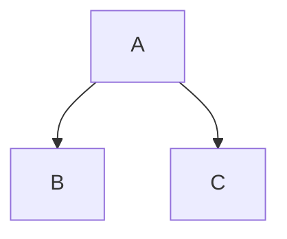
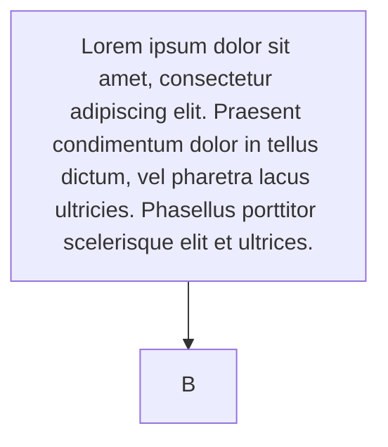

# Table of Contents

# Heading 1 Heading 1 Heading 1 Heading 1

## Heading 2 Heading 2 Heading 2 Heading 2

### Heading 3 Heading 3 Heading 3 Heading 3

#### Heading 4 Heading 4 Heading 4 Heading 4

##### Heading 5 Heading 5 Heading 5 Heading 5

# Paragraphs

Lorem ipsum dolor sit amet, consectetur adipiscing elit. Praesent condimentum dolor in tellus dictum, vel pharetra lacus ultricies. Phasellus porttitor scelerisque elit et ultrices. Donec auctor sapien finibus metus commodo, nec tempus tortor interdum. Vestibulum porttitor venenatis eros quis lacinia.

Duis aliquet ex eu scelerisque ultricies. Nam ac sagittis ligula. Vestibulum velit erat, tristique nec elit nec, venenatis ullamcorper mi. Aliquam sollicitudin finibus enim in volutpat. Duis cursus hendrerit turpis, vitae porta mi euismod rutrum. Suspendisse blandit aliquet rutrum. Nunc nec pharetra magna. Maecenas posuere in leo vitae tempus. Suspendisse potenti. Duis sed faucibus massa.

# Formatting

**Bold**, _Italic_, ~~Strikethrough~~,

# Links

[Link](https://example.com)
[Empty Link]()

# Horizontal Rule

---

# Lists

- Lorem ipsum dolor sit amet, consectetur adipiscing elit.
- Lorem ipsum dolor sit amet, consectetur adipiscing elit.
- Lorem ipsum dolor sit amet, consectetur adipiscing elit.

1. Lorem ipsum dolor sit amet, consectetur adipiscing elit.
2. Lorem ipsum dolor sit amet, consectetur adipiscing elit.
3. Lorem ipsum dolor sit amet, consectetur adipiscing elit.

- Lorem ipsum dolor sit amet, consectetur adipiscing elit.
  - Lorem ipsum dolor sit amet, consectetur adipiscing elit.
  - Lorem ipsum dolor sit amet, consectetur adipiscing elit.
  - Lorem ipsum dolor sit amet, consectetur adipiscing elit.
- Lorem ipsum dolor sit amet, consectetur adipiscing elit.
  1. Lorem ipsum dolor sit amet, consectetur adipiscing elit.
  2. Lorem ipsum dolor sit amet, consectetur adipiscing elit.
  3. Lorem ipsum dolor sit amet, consectetur adipiscing elit.

# Blockquotes

> Lorem ipsum dolor sit amet, consectetur adipiscing elit. Praesent condimentum dolor in tellus dictum, vel pharetra lacus ultricies.

With line break:

> Lorem ipsum dolor sit amet, consectetur adipiscing elit. Praesent condimentum dolor in tellus dictum, vel pharetra lacus ultricies.
>
> Phasellus porttitor scelerisque elit et ultrices. Donec auctor sapien finibus metus commodo, nec tempus tortor interdum. Vestibulum porttitor venenatis eros quis lacinia.

With `<cite>`:

> Lorem ipsum dolor sit amet, consectetur adipiscing elit. Praesent condimentum dolor in tellus dictum, vel pharetra lacus ultricies.
>
> Phasellus porttitor scelerisque elit et ultrices. Donec auctor sapien finibus metus commodo, nec tempus tortor interdum. Vestibulum porttitor venenatis eros quis lacinia.
>
> <footer><cite>Muhammad Rehan Saeed</cite></footer>

# Tables

| Tables        |      Are      |  Cool |
| ------------- | :-----------: | ----: |
| col 3 is      | right-aligned | $1600 |
| col 2 is      |   centered    |   $12 |
| zebra stripes |   are neat    |    $1 |
| zebra stripes |   are neat    |    $1 |
| zebra stripes |   are neat    |    $1 |
| zebra stripes |   are neat    |    $1 |
| zebra stripes |   are neat    |    $1 |
| zebra stripes |   are neat    |    $1 |

# Custom Containers

::: tip Title
This is a tip
:::

::: warning Title
This is a warning
:::

::: danger Title
This is a dangerous warning
:::

::: details Title
Some Code
:::

# Keyboard

Writing `||CTRL+C||` looks like ||CTRL+C|| and outputs `<kbd>CTRL+C</kbd>`.

# Syntax Highlighting

This is `inline` code.

```
// No Language
```

```js [Code Title Code Title]
// Code Title
```

```js line-numbers
// Line Numbers
// Line Numbers
// Line Numbers
// Line Numbers
// Line Numbers
// Line Numbers
// Line Numbers
// Line Numbers
// Line Numbers
// Line Numbers
// Line Numbers
// Line Numbers
// Line Numbers
// Line Numbers
// Line Numbers
```

```js
// Line Highlight
export default {
  data() {
    return {
      msg: "Line Highlight",
    };
  },
};
```

```js{2,4-5}
// Line Highlight
export default {
  data () {
    return {
      msg: 'Line Highlight'
    }
  }
}
```

```powershell
docker image build --tag foo:1.0.0 --label "build"="123" --label "changeset"="0d9c7d3b77817caab3977b16d1d76bb3eb024837" .
```

```js [Code Title Code Title Code Title Code Title Code Title Code Title Code Title Code Title Code Title Code Title Code Title Code Title Code Title Code Title] {2,4-5,9-10} line-numbers
// Code Title, Line Numbers, Line Highlight ----------------------------------------------
// Code Title, Line Numbers, Line Highlight
// Code Title, Line Numbers, Line Highlight
// Code Title, Line Numbers, Line Highlight
// Code Title, Line Numbers, Line Highlight
// Code Title, Line Numbers, Line Highlight
// Code Title, Line Numbers, Line Highlight
// Code Title, Line Numbers, Line Highlight
export default {
  data () {
    return {
      msg: 'All'
    }
  }
}
```

# Math

```
This is $ (a+b)^2 = a^2 + 2ab + b^2 $ inline math.
```

This is $ (a+b)^2 = a^2 + 2ab + b^2 $ inline math.

```
$$
(a+b)^2 = a^2 + 2ab + b^2
$$
```

$$
(a+b)^2 = a^2 + 2ab + b^2
$$

# Mermaid

```
flowchart TD
  A --> B
  A --> C
```



```
flowchart TD
  A[Lorem ipsum dolor sit amet, consectetur adipiscing elit. Praesent condimentum dolor in tellus dictum, vel pharetra lacus ultricies. Phasellus porttitor scelerisque elit et ultrices.] --> B
```



# Embed Code Snippets

`embed:foo.cs`

# Embed Images

Use ordinary Markdown for images. Small images are centred without being enlarged beyond their original dimensions. Large images can fill the wider image area, and all images shrink to fit narrow screens. No HTML wrapper or sizing class is needed.


To add a caption, wrap the Markdown image in `<figure>` and put a `<figcaption>` after it. Keep the blank lines around the Markdown image so it is parsed as Markdown rather than HTML:

```markdown
<figure>


<figcaption>A code-themed illustration.</figcaption>
</figure>
```

<figure>


<figcaption>A code-themed illustration.</figcaption>
</figure>

## Embed Videos

Use `<video>` on its own when a visible caption is not needed. Keep any required creator credit and source elsewhere in the article; the fallback link is not visible in browsers that support video.

```html
<video
  src="/videos/threeui-demonstration-960x720.mp4"
  controls
  playsinline
  preload="metadata"
  width="960"
  height="720"
  aria-label="ThreeUI demonstration of interactive Three.js components and landing pages">
  <a href="https://example.com/">Watch the video demonstration.</a>
</video>
```

Wrap the player in `<figure>` and add `<figcaption>` after it for visible context, creator credit and the original source:

```html
<figure>
  <video
    src="/videos/threeui-demonstration-960x720.mp4"
    controls
    playsinline
    preload="metadata"
    width="960"
    height="720"
    aria-label="ThreeUI demonstration of interactive Three.js components and landing pages">
    <a href="https://example.com/">Watch the video demonstration.</a>
  </video>
  <figcaption>
    Video demonstration by <a href="https://example.com/">Example Author</a>.
    <a href="https://example.com/">Source</a>.
  </figcaption>
</figure>
```

The caption credits the creator and links to the source; it is italicised and has spacing below it.

# Embed Youtube Video

https://www.youtube.com/watch?v=PGM_uBy99GA

# Embed Youtube Playlist

https://www.youtube.com/playlist?list=PLUAZAVKVXTmQEF67lddyErymHlBDaPpjU
